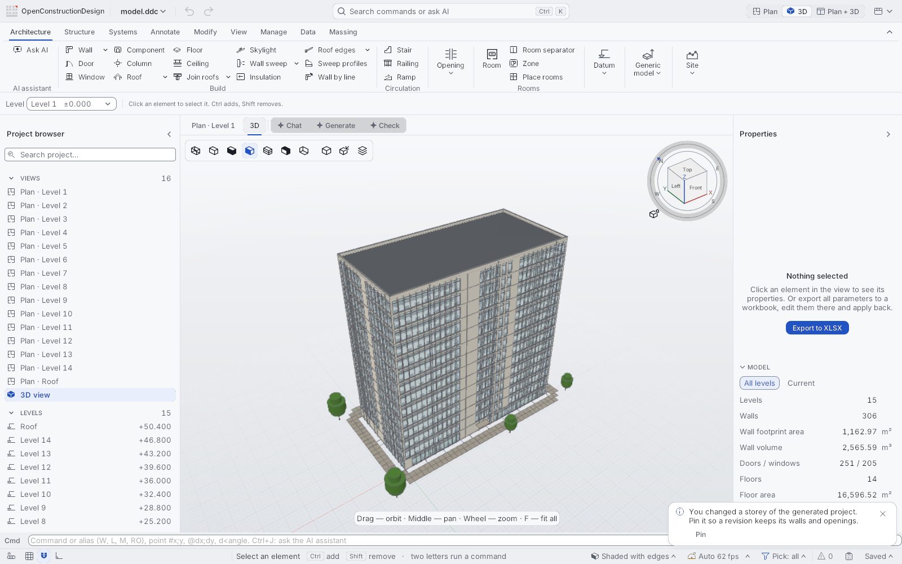
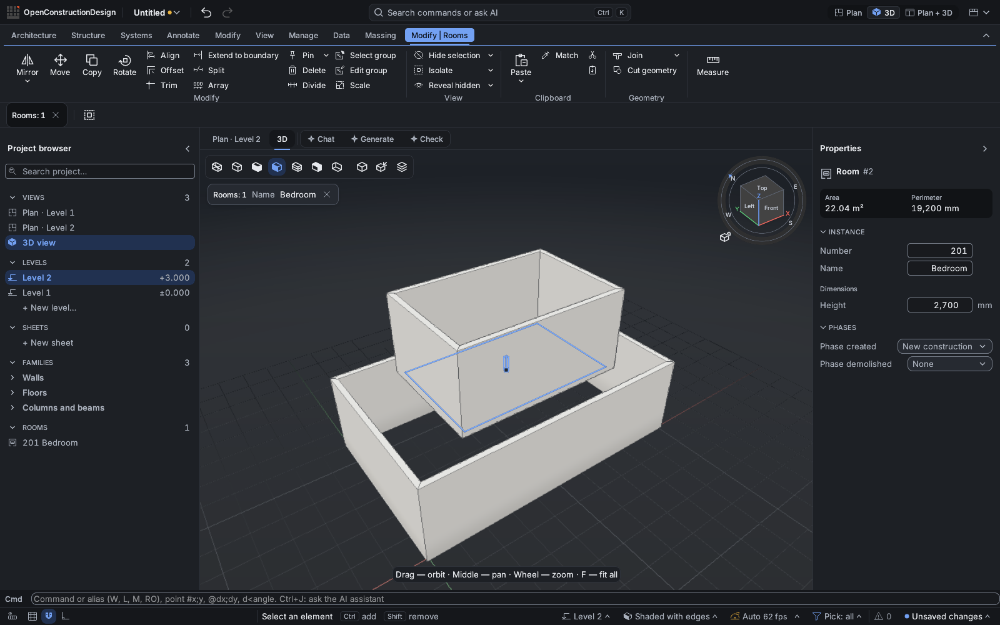

<p align="center"></p>

# OpenConstructionDesign

**A free, open-source CAD-BIM editor for the desktop, written in Rust.**

[](https://github.com/datadrivenconstruction/OpenConstructionDesign/actions/workflows/ci.yml)
[](LICENSE)
[](CHANGELOG.md)
[](docs/BUILDING.md)

<p align="center">
  
  
</p>

OpenConstructionDesign combines CAD precision with BIM data in one editor. It has its own
geometry kernel and its own file decoders, reads and writes IFC, keeps the whole model and its
change history in a single SQLite file, and runs on your machine. The built-in AI assistant
works with the provider you choose, including a local server, and never changes your model
until you press Apply.

> **Status: 0.9.0 preview.** The editor is usable, but the project file format, the APIs and
> the interface can still change between releases, and parts of the test suite are still being
> fixed (see CI). Keep the original of every model you open and do not use the editor as the
> only copy of production data. See [Limits of 0.9.0](#limits-of-090).

## Features

**Modeling**
- Levels, grids, reference planes, walls (layered types, automatic joins), floors, ceilings,
  roofs, stairs, railings, ramps, curtain walls, openings, doors, windows, rooms and zones.
- Own geometry kernel: exact predicates, B-rep solids, CSG, sweeps, NURBS, sketch constraints.
- Parametric families: components with types and parameters defined inside the model, with no
  separate family editor.
- Every edit is a journaled step with undo, redo, a per-change history with its author, and
  version comparison.

**Documentation and drawings**
- Plans, sections, elevations, 3D views, schedules, dimensions, tags, text, legends.
- Sheets with title blocks and views placed at scale; vector PDF and SVG export.

**Structure and MEP**
- Beams, columns, braces, structural walls and floors, footings, foundation slabs, and
  reinforcement that follows its host.
- Ducts, pipes, cable trays and conduits with fittings derived from the network; system
  checks and route proposals.

**IFC and other formats**
- Import IFC2X3, IFC4, IFC4X1 to IFC4X3 and `.ifczip`; export IFC2X3, IFC4 and IFC4.3.
- Read `.dwg` and `.dxf` with independent decoders. The original file is never modified.
- Export glTF, STEP, STL, OBJ, 3MF; exchange issues as BCF 2.1/3.0.
- `.rvt` through an optional, separately distributed bridge module that speaks the published
  [bridge protocol](docs/plugins/BRIDGE_PROTOCOL.md); it is not part of this repository.
- Clash detection, rule checks and model integrity checks.

**Scripting and automation**
- JSON edit scripts with preview, and recording of actions into a script.
- Sandboxed Lua geometry scripts (no files, network, clock or randomness).
- The headless `ddc` command-line tool (`open`, `info`, `batch`, `run`).

**AI assistant**
- Describe a change in words. The assistant plans on a scratch copy of the model and shows a
  plan card, a preview and a diff. An applied plan is one undo step.
- Bring your own provider (a compatible HTTP chat interface or a local server). Keys go to the
  OS key store; a local-only mode keeps requests on your computer and local network.
- A built-in MCP server lets external agents use the same tools under the same Apply rule.

**Spreadsheets**
- Round-trip element parameters through XLSX; an import is one undo step with a per-cell
  report.
- Query elements and open them as an editable table.

## Screenshots

Generated by the editor itself (projects built by the assistant and built-in demo scenes; no
third-party models).

| | |
|---|---|
|  |  |
|  |  |
|  |  |

## Install

- **Windows desktop.** Download the installer (Inno Setup) from the Releases page of this
  repository and run it. Windows 10 or 11, x86_64.

## Build from source (Windows)

Windows 10 or 11 on x86_64 is the primary platform. Details and other platforms:
[docs/BUILDING.md](docs/BUILDING.md).

1. Install Git, the MSVC build tools ("Desktop development with C++"; a C compiler is needed
   for the bundled SQLite and Lua) and Rust via [rustup](https://rustup.rs/) (stable, MSVC
   target, version 1.89 or newer; CI builds with 1.95.0). Then run `rustup component add rustfmt clippy`.
2. Clone and build in a new terminal:

   ```powershell
   git clone <repository-url> ocd
   cd ocd
   cargo build --release -p ddc-app -p ddc-cli
   ```

3. Run; binaries are in `target\release\`:

   ```powershell
   cargo run --release -p ddc-app             # the editor
   cargo run --release -p ddc-cli -- --help   # headless CLI (binary name: ddc)
   ```

   If the window does not open or rendering is broken, start with `--safe-graphics`.

CLI examples:

```sh
ddc info model.ifc
ddc open model.ifc --export xlsx model.xlsx --export ifc4 model-ifc4.ifc
ddc run project.ddc tower.lua --out tower.ddc --param height="40 m"
```

## Platform support

| Platform | Status |
|---|---|
| Windows 10/11, x86_64 | Supported; primary development platform; installer provided. |
| Linux | Library crates and the headless `ddc` CLI (built and tested in CI). The editor window is not supported yet. |
| macOS | Code paths exist; not regularly built or tested. |
| Browser (wasm32) | Not available in this repository. |

Details: [docs/BUILDING.md](docs/BUILDING.md).

## Limits of 0.9.0

- The `.dwg` and `.dxf` decoders are independent implementations. They cover common
  building elements and geometry, not every feature of those formats. Compare imported models
  with the source before relying on them.
- The AI assistant can make mistakes. Always read the preview and diff. Quality depends on the
  provider and model you choose; small local models handle only simple requests.
- Linux and macOS: only the library crates and the headless CLI are supported. The editor
  window is Windows-first.
- The structural solver is a library and is not yet exposed in the editor.
- The project file format is not frozen; keep an IFC export for long-term storage.
- Very large models can be slow.
- Interface languages: English and Russian; other languages are catalog stubs.

## Roadmap

Planned, with no dates: a frozen project file format, broader `.dwg` coverage, the structural
solver inside the editor, more interface languages, and editor builds beyond Windows.

Plans can change; the [changelog](CHANGELOG.md) lists what actually shipped.

## Documentation

| Document | Contents |
|---|---|
| [docs/user/getting-started.md](docs/user/getting-started.md) | First model, files, saving |
| [docs/user/ai-assistant.md](docs/user/ai-assistant.md) | Providers, preview, Apply |
| [docs/user/formats.md](docs/user/formats.md) | Supported formats and IFC round trip |
| [docs/user/families.md](docs/user/families.md) | Parametric families |
| [docs/USER_GUIDE.md](docs/USER_GUIDE.md) | Core workflows and shortcuts |
| [docs/ARCHITECTURE.md](docs/ARCHITECTURE.md) | Crates, data flow, journal, AI contract |
| [docs/BUILDING.md](docs/BUILDING.md) | Building and testing |

## Contributing

Contributions are welcome. Read [CONTRIBUTING.md](CONTRIBUTING.md). Every contributor signs
the [Contributor License Agreement](CLA.md) before the first merge and signs off each commit
(`git commit -s`). Please follow the
[Code of Conduct](CODE_OF_CONDUCT.md).

## Security

Do not report vulnerabilities in public issues; see [SECURITY.md](SECURITY.md).

## Licence

Licensed under the [GNU Affero General Public License, version 3 only](LICENSE)
(AGPL-3.0-only). If you run a modified version as a network service, you must offer its
source to that service's users. Third-party components keep their own licences; see
[THIRD_PARTY_LICENSES.txt](THIRD_PARTY_LICENSES.txt) and [NOTICE](NOTICE). A separate commercial licence
is available for use that the AGPL does not fit; see [COMMERCIAL.md](COMMERCIAL.md).
