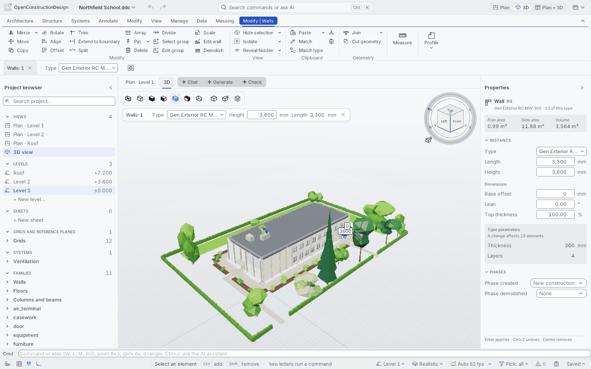
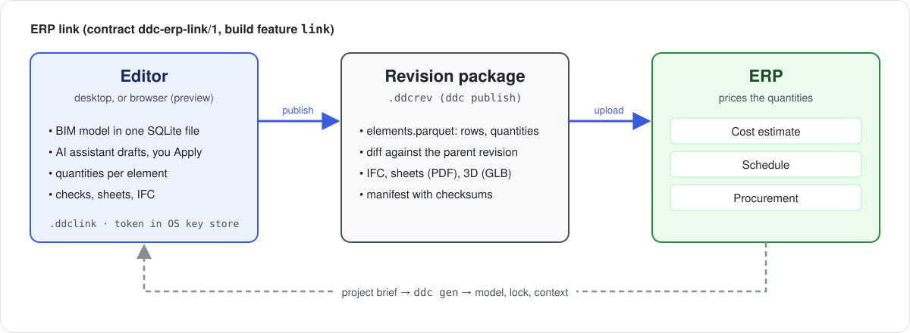
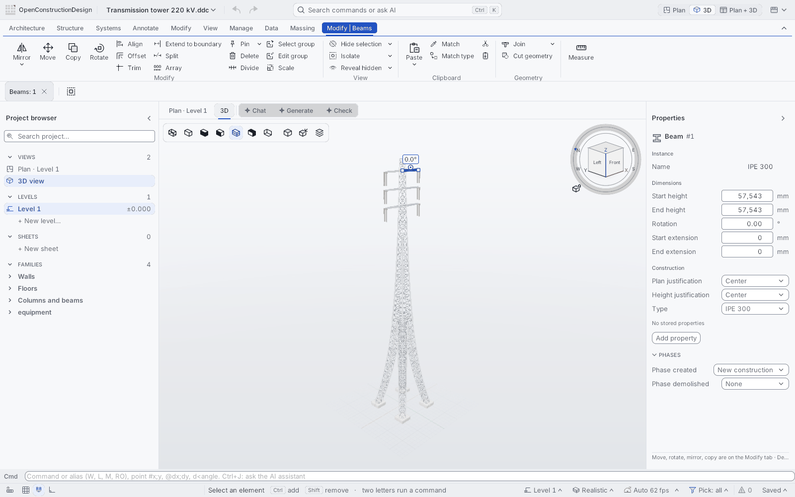
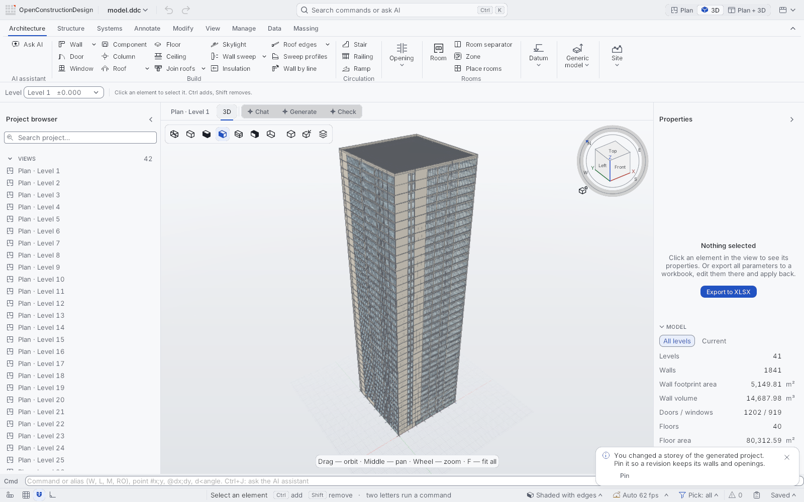
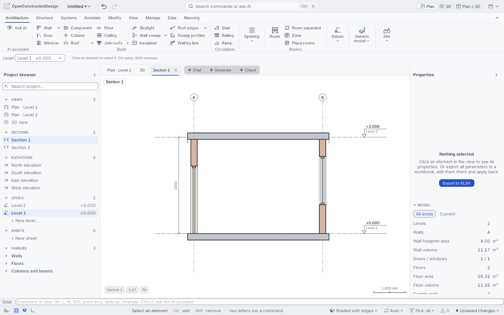
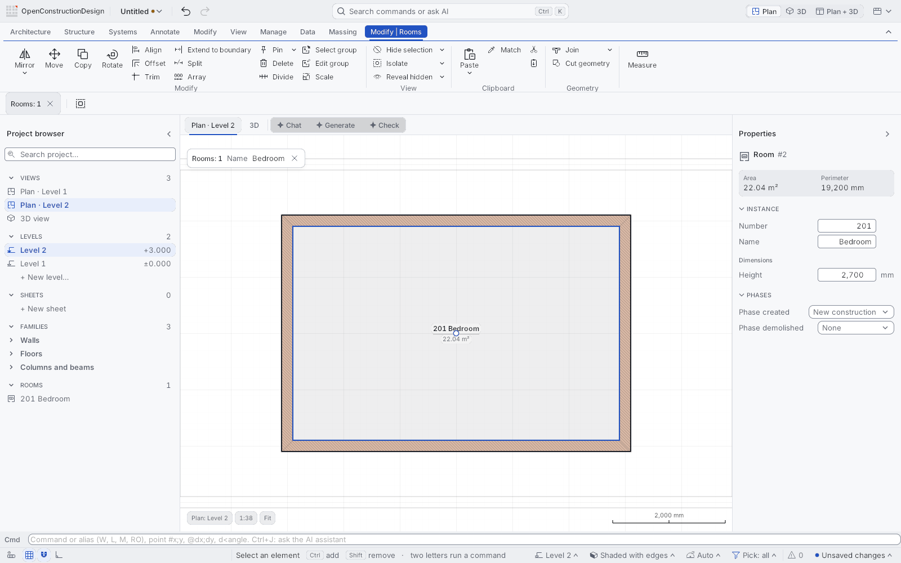

<p align="center">
  <picture>
    <source media="(prefers-color-scheme: dark)" srcset="crates/app/data/brand/design-lockup-dark.svg">
    
  </picture>
</p>

# OpenConstructionDesign

**A free, open-source CAD-BIM editor with its own AI assistant, a link to cost estimation, and a
browser build on the way.**

[](https://github.com/datadrivenconstruction/OpenConstructionDesign/actions/workflows/ci.yml)
[](LICENSE)
[](CHANGELOG.md)
[](docs/BUILDING.md)

<p align="center">
<picture>
  <source media="(prefers-color-scheme: dark)" srcset="docs/images/school-dark.png">
  
</picture>
</p>

OpenConstructionDesign combines CAD precision with BIM data in one editor. It has its own
geometry kernel and file decoders, reads and writes IFC, and keeps the whole model and its
change history in a single SQLite file on your machine.

OpenConstructionDesign is part of the OpenConstruction family:

| Product | What it does | Links |
|---|---|---|
| **OpenConstructionDesign** | CAD-BIM editor with an AI assistant (this repository) | Website: coming soon <!-- website URL: pending --> |
| **OpenConstructionERP** | Cost estimation, scheduling and procurement from model quantities | [openconstructionerp.com](https://openconstructionerp.com) · [GitHub](https://github.com/datadrivenconstruction/OpenConstructionERP) |
| **OpenConstructionAcademy** | Courses and guides on data-driven construction | [openconstructionacademy.com](https://openconstructionacademy.com) |

> **Status: 0.9.0 preview.** The editor is usable, but the project file format, the APIs and
> the interface can still change between releases. Keep the original of every model you open
> and do not use the editor as the only copy of production data. See [Limits of 0.9.0](#limits-of-090).

## 1. An AI assistant that builds and checks models

Describe a building, a plant or a structure in words. The assistant plans on a scratch copy
of the model with the same tools you use, runs the model checks on its draft, and shows a plan
card, a 3D preview and a diff. Nothing reaches your model until you press **Apply**, and an
applied plan is one undo step.

- Generators for whole projects: houses, offices, hospitals, plants, lattice towers,
  free-form massing, with furniture, services, site and drawing sets.
- Bring your own provider: any compatible HTTP chat interface, or a server on your own
  machine. Keys stay in the OS key store; a local-only mode keeps every request on your
  network.
- A built-in MCP server lets external AI clients use the same tools under the same Apply rule.

The transmission tower in the gallery was built with the same tools the assistant uses.

## 2. Quantities that flow into cost estimation

The model is data first: every element carries its parameters and quantities, and they leave
the editor in forms an estimating or ERP system can read, including
[OpenConstructionERP](https://openconstructionerp.com).

<p align="center">
  
</p>

Schedules and quantity take-off come straight from the model. The XLSX round trip exports
parameters, lets you edit them in any spreadsheet, and imports them back as one undo step with
a per-cell report.

- **ERP link** (build feature `link`): `ddc gen --brief` turns a project brief from the ERP
  into a model; `ddc publish` sends a model back as a revision package with element rows
  (`elements.parquet`), quantities, a diff against the parent revision, sheets, IFC and 3D
  geometry. The ERP prices the quantities; the editor never invents a cost.
- Linked sessions open from a `.ddclink` file; the project token lives only in the OS key
  store.

<!-- placeholder for the owner: docs/images/erp-cost-table.png - the ERP cost view filled from a published revision (shot on the ERP side). -->

## 3. In the browser, nothing to install

The same editor is being built for the browser (WebAssembly, WebGL2): open a project from the
ERP or a link, look at it, ask the assistant, and save a draft revision, with nothing to
install. The browser build is in preview and is not part of this repository yet; the desktop
editor below is the released one.

<!-- placeholder for the owner: docs/images/browser-editor.png - the editor running in a browser tab (shot on the machine with the browser build). -->

## Gallery

Rendered by the editor itself; no third-party models. Each image follows your GitHub theme
(light or dark).

<table>
<tr>
<td width="50%">

<picture>
  <source media="(prefers-color-scheme: dark)" srcset="docs/images/school-dark.png">
  
</picture>

School, 2 storeys: 1,348 elements, landscaped plot.

</td>
<td width="50%">

<picture>
  <source media="(prefers-color-scheme: dark)" srcset="docs/images/lattice-tower-dark.png">
  
</picture>

Transmission tower, 220 kV, built with the assistant's tools: 2,235 elements.

</td>
</tr>
</table>

| | |
|---|---|
|  |  |
| Office block, 15 levels: 306 walls, 251 doors, 205 windows. | Tower, 41 levels: 1,841 walls, 80,312 m2 of floor area. |
|  |  |
| Section with grids, level markers and a dimension. | Plan with wall hatch and a room tag (22.04 m2). |

## Features

**Modeling**
- Levels, grids, reference planes, walls (layered types, automatic joins), floors, ceilings,
  roofs, stairs, railings, ramps, curtain walls, openings, doors, windows, rooms and zones.
- Own geometry kernel: exact predicates, B-rep solids, CSG, sweeps, NURBS, sketch constraints.
- Parametric families: components with types and parameters defined inside the model, with no
  separate family editor.
- Every edit is a journaled step with undo, redo, a per-change history with its author, and
  version comparison.

**Documentation and drawings**
- Plans, sections, elevations, 3D views, schedules, dimensions, tags, text, legends.
- Sheets with title blocks and views placed at scale; vector PDF and SVG export.

**Structure and MEP**
- Beams, columns, braces, structural walls and floors, footings, foundation slabs, and
  reinforcement that follows its host; steel connections with plates and bolts.
- Ducts, pipes, cable trays and conduits with fittings derived from the network; system
  checks and route proposals.

**IFC and other formats**
- Import IFC2X3, IFC4, IFC4X1 to IFC4X3 and `.ifczip`; export IFC2X3, IFC4 and IFC4.3.
- Read `.dwg` and `.dxf` with independent decoders. The original file is never modified.
- Export glTF, STEP, STL, OBJ, 3MF; exchange issues as BCF 2.1/3.0.
- `.rvt` through an optional, separately distributed bridge module that speaks the published
  [bridge protocol](docs/plugins/BRIDGE_PROTOCOL.md); it is not part of this repository.
- Clash detection, rule checks and model integrity checks.

**Scripting and automation**
- JSON edit scripts with preview, and recording of actions into a script.
- Sandboxed Lua geometry scripts (no files, network, clock or randomness).
- The headless `ddc` command-line tool (`open`, `info`, `batch`, `run`; `gen` and `publish`
  with the ERP link).

**Spreadsheets**
- Round-trip element parameters through XLSX; an import is one undo step with a per-cell
  report.
- Query elements and open them as an editable table.

## Install

- **Windows desktop.** Download the installer (Inno Setup) from the Releases page of this
  repository and run it. Windows 10 or 11, x86_64.

## Build from source (Windows)

Windows 10 or 11 on x86_64 is the primary platform. Details and other platforms:
[docs/BUILDING.md](docs/BUILDING.md).

1. Install Git, the MSVC build tools ("Desktop development with C++"; a C compiler is needed
   for the bundled SQLite and Lua) and Rust via [rustup](https://rustup.rs/) (stable, MSVC
   target, version 1.89 or newer; CI builds with 1.95.0). Then run `rustup component add rustfmt clippy`.
2. Clone and build in a new terminal:

   ```powershell
   git clone <repository-url> ocd
   cd ocd
   cargo build --release -p ddc-app -p ddc-cli
   ```

3. Run; binaries are in `target\release\`:

   ```powershell
   cargo run --release -p ddc-app             # the editor
   cargo run --release -p ddc-cli -- --help   # headless CLI (binary name: ddc)
   ```

   If the window does not open or rendering is broken, start with `--safe-graphics`.

CLI examples:

```sh
ddc info model.ifc
ddc open model.ifc --export xlsx model.xlsx --export ifc4 model-ifc4.ifc
ddc run project.ddc tower.lua --out tower.ddc --param height="40 m"
```

## Platform support

| Platform | Status |
|---|---|
| Windows 10/11, x86_64 | Supported; primary development platform; installer provided. |
| Linux | Library crates and the headless `ddc` CLI (built and tested in CI). The editor window is not supported yet. |
| macOS | Code paths exist; not regularly built or tested. |
| Browser (wasm32) | Preview; the browser build is not part of this repository yet. |

Details: [docs/BUILDING.md](docs/BUILDING.md).

## Limits of 0.9.0

- The `.dwg` and `.dxf` decoders are independent implementations. They cover common
  building elements and geometry, not every feature of those formats. Compare imported models
  with the source before relying on them.
- The AI assistant can make mistakes. Always read the preview and diff. Quality depends on the
  provider and model you choose; small local models handle only simple requests.
- Linux and macOS: only the library crates and the headless CLI are supported. The editor
  window is Windows-first.
- The structural solver is a library and is not yet exposed in the editor.
- The project file format is not frozen; keep an IFC export for long-term storage.
- Very large models can be slow.
- Interface languages: English and Russian; other languages are catalog stubs.

## Roadmap

Planned, with no dates: a frozen project file format, broader `.dwg` coverage, the structural
solver inside the editor, more interface languages, and editor builds beyond Windows.

Plans can change; the [changelog](CHANGELOG.md) lists what actually shipped.

## Documentation

| Document | Contents |
|---|---|
| [docs/user/getting-started.md](docs/user/getting-started.md) | First model, files, saving |
| [docs/user/ai-assistant.md](docs/user/ai-assistant.md) | Providers, preview, Apply |
| [docs/user/formats.md](docs/user/formats.md) | Supported formats and IFC round trip |
| [docs/user/families.md](docs/user/families.md) | Parametric families |
| [docs/USER_GUIDE.md](docs/USER_GUIDE.md) | Core workflows and shortcuts |
| [docs/ARCHITECTURE.md](docs/ARCHITECTURE.md) | Crates, data flow, journal, AI contract |
| [docs/BUILDING.md](docs/BUILDING.md) | Building and testing |

## Contributing

Contributions are welcome. Read [CONTRIBUTING.md](CONTRIBUTING.md). Every contributor signs
the [Contributor License Agreement](CLA.md) before the first merge and signs off each commit
(`git commit -s`). Please follow the
[Code of Conduct](CODE_OF_CONDUCT.md).

## Security

Do not report vulnerabilities in public issues; see [SECURITY.md](SECURITY.md).

## Licence

Licensed under the [GNU Affero General Public License, version 3 only](LICENSE)
(AGPL-3.0-only). If you run a modified version as a network service, you must offer its
source to that service's users. Third-party components keep their own licences; see
[THIRD_PARTY_LICENSES.txt](THIRD_PARTY_LICENSES.txt) and [NOTICE](NOTICE). A separate commercial licence
is available for use that the AGPL does not fit; see [COMMERCIAL.md](COMMERCIAL.md).
