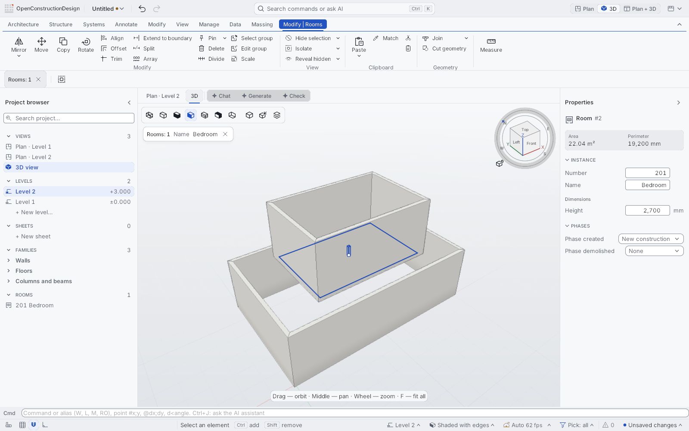
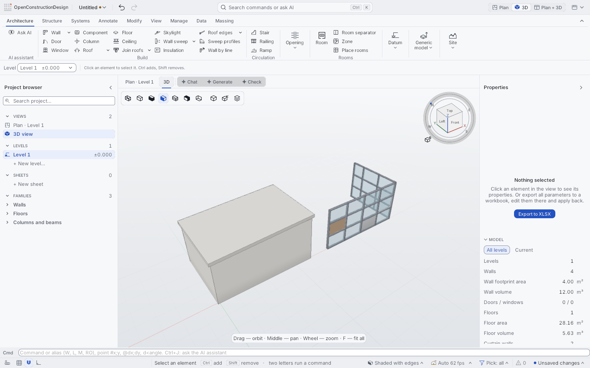

<p align="center"></p>

# OpenConstructionDesign

**Free, open-source CAD-BIM editor in Rust — AGPL-3.0**

[](https://github.com/datadrivenconstruction/OpenConstructionDesign/actions/workflows/ci.yml)
[](LICENSE)
[](CHANGELOG.md)
[](docs/BUILDING.md)

<p align="center">
  
  
</p>

OpenConstructionDesign combines CAD precision with BIM data in one desktop editor. It has its
own geometry kernel and decoders, reads and writes IFC, keeps the whole model and its change
history in a single file, and runs entirely on your machine. The built-in AI assistant works
with the provider you choose, including local servers, and never changes your model until you
press Apply. `.rvt` files are opened through an optional external bridge module (not part of
this repository) that speaks the published
[bridge protocol](docs/plugins/BRIDGE_PROTOCOL.md).

> **0.9.0 preview: part of the test suite is still being fixed, see CI.** The editor is usable,
> but file format, APIs and user interface can still change between releases. Keep the original
> of every model you open and do not use the editor as the only copy of production data.
> See [Limits of 0.9.0](#limits-of-090).

## What you can do

- **Open** IFC (IFC2X3, IFC4, IFC4X1 to IFC4X3, `.ifczip`) and `.dwg`/`.dxf` files; `.rvt` through
  an optional external bridge module (not part of this repository).
- **Edit** levels, grids, walls, floors, roofs, stairs, openings, doors, windows, structure,
  MEP systems, rooms. Every edit is a journaled step with undo, redo and per-change history.
- **Parametric families.** Components with types and parameters, defined in the model; no
  separate family editor.
- **IFC round trip.** Import IFC, edit, export IFC2X3, IFC4 or IFC4.3; the CLI converts in
  batch.
- **Document.** Plans, sections, elevations, schedules, sheets with title blocks, PDF and SVG
  export.
- **Ask the AI assistant.** Describe a change in words. The assistant plans on a scratch copy
  of the model and shows a preview and a diff. Nothing reaches your model until you press
  **Apply**, and an applied plan is one undo step.
- **Check.** Clash detection, rule checks, model integrity checks.
- **Exchange.** XLSX round trip, BCF 2.1/3.0, glTF, STEP, STL, OBJ, 3MF.
- **Script.** JSON edit scripts, sandboxed Lua geometry scripts, and the headless `ddc` CLI.

## Gallery

Generated by the editor itself (projects built by the assistant and built-in demo scenes; no third-party models).

| | |
|---|---|
|  |  |
|  |  |
|  |  |

## Install

- **Windows desktop.** Download the installer (Inno Setup) from the Releases page of this
  repository and run it. Windows 10 or 11, x86_64.

## Build from source (Windows)

Windows 10 or 11 on x86_64 is the primary platform. Details and other platforms:
[docs/BUILDING.md](docs/BUILDING.md).

1. Install Git, the MSVC build tools ("Desktop development with C++"; a C compiler is needed
   for the bundled SQLite and Lua) and Rust via [rustup](https://rustup.rs/) (stable, MSVC
   target). Then run `rustup component add rustfmt clippy`.
2. Clone and build in a new terminal:

   ```powershell
   git clone <repository-url> ocd
   cd ocd
   cargo build --release -p ddc-app -p ddc-cli
   ```

3. Run; binaries are in `target\release\`:

   ```powershell
   cargo run --release -p ddc-app             # the editor
   cargo run --release -p ddc-cli -- --help   # headless CLI (binary name: ddc)
   ```

   If the window does not open or rendering is broken, start with `--safe-graphics`.

CLI examples:

```sh
ddc info model.ifc
ddc open model.ifc --export xlsx model.xlsx --export ifc4 model-ifc4.ifc
ddc run project.ddc tower.lua --out tower.ddc --param height="40 m"
```

## Limits of 0.9.0

- The `.dwg` decoder is an independent implementation. They cover common
  building elements and geometry, not every feature of those formats. Compare imported models
  with the source before relying on them.
- The AI assistant can make mistakes. Always read the preview and diff. Quality depends on the
  provider and model you choose; small local models handle only simple requests.
- Linux and macOS: only the library crates and the headless CLI are supported. The editor
  window is Windows-first.
- The structural solver is a library and is not yet exposed in the editor.
- The project file format is not frozen; keep an IFC export for long-term storage.
- Very large models can be slow.
- Interface languages: English and Russian; other languages are catalog stubs.


## Roadmap

- **0.10:** interface redesign, shared type and product catalogs, more interface languages.
- **Toward 1.0:** a frozen project file format, the structural solver inside the editor,
  Linux and macOS editor builds.

Plans can change; the [changelog](CHANGELOG.md) lists what actually shipped.

## Roadmap

Toward 1.0: freeze the project file format, broaden `.dwg` coverage, expose the
structural solver in the editor, extend families and the sheet toolset, improve large-model
performance, and add interface languages. A browser build is planned; the model, geometry and
solver crates already avoid APIs that do not exist on wasm32. Plans are tracked in the issue tracker.

## Documentation

| Document | Contents |
|---|---|
| [docs/user/getting-started.md](docs/user/getting-started.md) | First model, files, saving |
| [docs/user/ai-assistant.md](docs/user/ai-assistant.md) | Providers, preview, Apply |
| [docs/user/formats.md](docs/user/formats.md) | Supported formats and IFC round trip |
| [docs/user/families.md](docs/user/families.md) | Parametric families |
| [docs/USER_GUIDE.md](docs/USER_GUIDE.md) | Core workflows and shortcuts |
| [docs/ARCHITECTURE.md](docs/ARCHITECTURE.md) | Crates, data flow, journal, AI contract |
| [docs/BUILDING.md](docs/BUILDING.md) | Building and testing |

## Contributing

Contributions are welcome. Read [CONTRIBUTING.md](CONTRIBUTING.md). Every contributor signs
the [Contributor License Agreement](CLA.md) before the first merge and signs off each commit
(`git commit -s`). Please follow the [Code of Conduct](CODE_OF_CONDUCT.md).

## Security

Do not report vulnerabilities in public issues; see [SECURITY.md](SECURITY.md).

## Licence

Licensed under the [GNU Affero General Public License, version 3 only](LICENSE)
(AGPL-3.0-only). If you run a modified version as a network service, you must offer its
source to that service's users. Third-party components keep their own licences; see
[THIRD_PARTY_LICENSES.txt](THIRD_PARTY_LICENSES.txt) and [NOTICE](NOTICE). Separate commercial
terms are described in [COMMERCIAL.md](COMMERCIAL.md).
